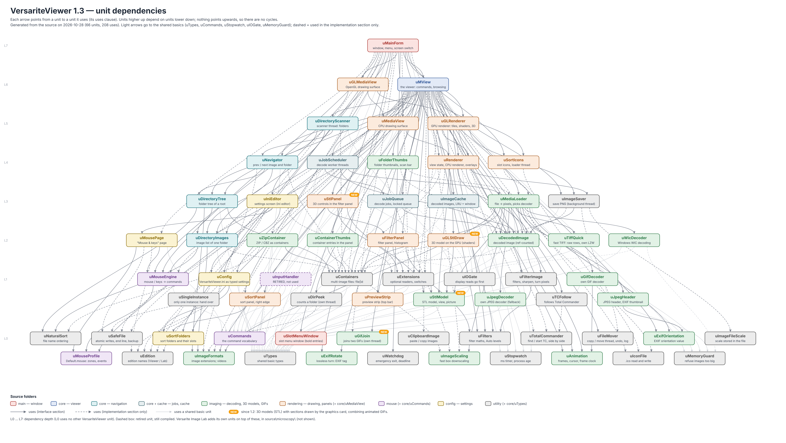
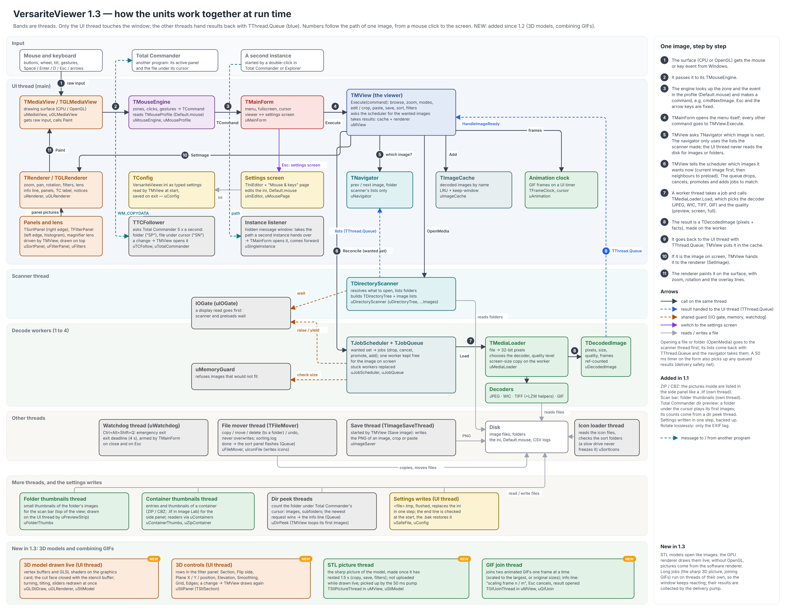

# How to read this

Every unit in `source\` starts with a header in the same layout:

| Section | What it says |
|---|---|
| **Purpose** | what the unit is for, in the program's terms |
| **Owns** | the objects, threads, timers and files it creates and frees |
| **Knows** | what it uses but does not own (handed in, global, callbacks) |
| **Responsibilities** | what it does |
| **Does NOT** | what it leaves to others, and to whom |
| **Threads** | which thread runs its code, and how shared data is protected |
| **Uses (MView units)** | generated from its `uses` clauses, plus the libraries (the headers keep the old name) |
| **Used by** | generated: which units use it |

Extra sections (Rules, Notes, Flow, Delivery safety net, ...) follow after these. The header is the
first thing to read before changing a unit; this document is the map that ties them together.

# What changed since 1.0

The program is now called **VersariteViewer** (formerly MView); its microscopy edition is
**Versarite Image Lab**. The project files are VersariteViewer.lpi / .lpr (the edition: VersariteImageLab.lpi / .lpr); the
units keep their names (uMView, TMView …). The program is VersariteViewer.exe, its settings
VersariteViewer.ini (an MView.ini is taken over at the first start).

Release 1.1 adds these units (marked 1.1 in the table further down) without changing the
layering: no unit uses one in a higher layer, still no cycles.

- **The editions** (Day 25): uEdition (which program this is), uExtensions (the plug-in points)
  and uContainers (files that hold several images). They let the microscopy edition, a second
  program from the same source tree, plug itself in without the core naming it.
  uContainerThumbs makes a container's thumbnails on a thread of its own.
- **Copy and save** (Day 25 / 26): uClipboardImage (Copy image), uImageFileScale (a TIFF / PNG
  keeps its scale).
- **The testers' requests** (Day 27): uSlotMenuWindow (the sort panel's folder menu as an own
  window), uPreviewStrip (the scan bar at the top) with uFolderThumbs (its thumbnails, on a thread
  of its own, through its own TMediaLoader). uSortFolders holds several folder lists and the Rapid
  sorting list; uMouseProfile holds single keys; uMouseEngine watches the top and bottom edges.
- **Safe settings** (Day 28): uSafeFile writes the ini in one step (a .tmp file, flushed, then
  replacing the old one); the end line is checked at the start, and the .bak copy restores a
  damaged ini.
- **The second round** (Day 30): uZipContainer (ZIP and CBZ archives as containers, in both
  editions), uDirPeek (counts a folder for the Total Commander dir preview, on threads of its own)
  and uExifRotate (lossless rotation: only the JPEG's EXIF orientation tag changes).
  uSortFolders gained copy / cut / paste of entries between lists.
- **Release 1.2** (Day 31): no new units, so the dependency picture (redrawn for 1.2) shows the same
  62 units and 192 uses. TMView gained the slide show, the leave-guard for unsaved images and the
  aiming loupe (drawn by both renderers); uSortFolders takes the Rapid Sorting folders from the
  settings; uExtensions gained plug-in points for the Lab: ShowImageInViewer (an edition's image
  shown as a crop), the aiming loupe, the edition's Undo joined with the viewer's (NextUndoStamp),
  the image's own pixels (GetImagePixels) and the edition's ini keys (in uEdition:
  RegisterEditionKey).
- **Release 1.3** (Days 32 to 34): four new units, so the dependency picture (redrawn for 1.3)
  shows 66 units and 208 uses, still without cycles. uStlModel reads an STL model and holds its view;
  uGLStlDraw draws it on the graphics card (vertex buffers, GLSL shaders, the cut face closed with
  the stencil buffer), called by uGLRenderer; uStlPanel puts the 3D controls into the filter panel;
  uGifJoin joins two animated GIFs one frame at a time. TMView runs two new threads: the sharp
  picture of a model (TStlPictureThread) and the joining of GIFs (TGifJoinThread), both picked up
  by the delivery pump.

# Picture 1 — unit dependencies

{width=100%}

Arrows point from a unit to the units it uses. The layers (L0 at the bottom to L7 at the top) are the
dependency depth: a unit only uses units in lower layers, so there are **no cycles**. uMainForm is the
only unit that sees everything; the imaging units never see the window, and the utility units see
nothing of the viewer at all. Layers with many units are drawn as two staggered rows. Units marked
NEW came after 1.2 (the list above). Versarite Image Lab's own units (`source\microscopy\`) sit on
top of these and are not drawn.

# Picture 2 — at run time

{width=100%}

The bands are threads. Only the UI thread touches the window and the renderers. The scanner thread,
the decode workers and the save thread never call into the UI; they hand their results back with
`TThread.Queue` (blue in the picture), and a 50 ms timer on the form picks up anything a lost wake-up
left in the queue (the delivery safety net in uMView). The I/O gate lets the image on screen read
the disk first; the memory guard refuses images that would not fit; the watchdog ends the program if
a shutdown hangs.

The sort and filter panels and the magnifier lens live on the UI thread and are drawn by the
renderers on top of the image; copies and moves run on the file mover thread, icon files are read on
a loader thread of their own; the Total Commander follower asks Total Commander five times a second
through window messages; a second instance hands its path to the running one through a hidden
message window and ends.

New in 1.3 (the bottom band, NEW): a 3D model is drawn live on the UI thread by the GPU renderer
(uGLStlDraw), with its controls in the filter panel (uStlPanel); its sharp picture and the joining
of two GIFs run on threads of their own, polled by the delivery pump.

Added in 1.1 (the band above it): the scan bar's thumbnails, a container's entries and
thumbnails (ZIP / CBZ; .lif in Image Lab) and the dir peek each run on threads of their own and
hand their results back with `TThread.Queue`; the settings are written on the UI thread through
uSafeFile.

# The units in one line each

| Folder | Unit | Purpose | Runs on |
|---|---|---|---|
| main | uMainForm | The window: creates the viewer or the settings screen, the menu, fullscreen, cursor hiding; switches viewer ↔ settings (Esc). | UI |
| main | uSlotMenuWindow | **1.1** The sort panel's folder menu as an own window: stays open while moving, Move up / down repeat while held. | UI |
| core | uMView | The viewer: carries out every command, browsing, modes, edit / crop / paste / save; asks for images and takes the results. | UI |
| core | uCommands | The command vocabulary (TCommand) that every input source produces. | any |
| core | uTypes | Small shared types and their names in the ini. | any |
| core | uNavigator | Which folder and image are current; what next / previous mean. | UI |
| core | uDirectoryTree | The folders under the root as a tree, in visiting order. | scanner, then UI |
| core | uDirectoryImages | The image list of one folder, sorted. | scanner, then UI |
| core | uJobQueue | Decode jobs in a locked queue. | UI + workers |
| core | uJobScheduler | The decode worker threads; wanted set → jobs; results back to the UI. | UI + workers |
| core | uMediaView | The CPU drawing surface; passes input to its mouse engine. | UI |
| navigation | uDirectoryScanner | The scanner thread: resolves what to open, lists folders, builds the tree. | scanner |
| cache | uImageCache | Decoded images kept by name (LRU plus keep-window). | UI |
| imaging | uMediaLoader | File → pixels: picks the decoder and the quality level, makes the screen copy. | workers |
| imaging | uDecodedImage | A decoded image, read-only and reference-counted. | any |
| imaging | uJpegDecoder | Own JPEG decoder (fallback after WIC; cancellable). | workers |
| imaging | uJpegHeader | JPEG header and EXIF thumbnail without reading the whole file. | workers |
| imaging | uExifOrientation | The EXIF orientation value. | workers |
| imaging | uTiffQuick | Fast TIFF: only the needed rows of raw TIFFs, own parallel LZW. | workers (+ helpers) |
| imaging | uWicDecoder | Decoding through Windows WIC, in bands for huge PNG / TIFF / BMP. | workers |
| imaging | uGifDecoder | Own GIF decoder: first frame fast, all frames on demand. | workers |
| imaging | uGifJoin | **1.3** Joins two animated GIFs (original sizes, or scaled to the larger), one frame at a time, with progress and cancel. | own thread |
| imaging | uStlModel | **1.3** STL models (binary and ASCII): reading, the view (turn, tilt, section), the software picture. | workers, own thread, UI |
| imaging | uAnimation | Animation frames, the frame cursor and the frame clock. | workers, then UI |
| imaging | uImageScaling | Fast box downscaling for screen copies. | workers |
| imaging | uImageFormats | The one list of image file extensions (1.1: also the formats only Windows' codecs read, and which codec is missing). | any |
| imaging | uContainerThumbs | **1.1** A container's entries and their thumbnails, on a thread of its own (ZIP / CBZ; .lif in Image Lab). | own thread |
| imaging | uFolderThumbs | **1.1** Thumbnails for the scan bar, on a thread of its own: the image under the mouse first. | own thread |
| imaging | uExifRotate | **1.1** Lossless rotation: sets a JPEG's EXIF orientation tag (patched, inserted into IFD0, or a new APP1); the pixels stay untouched. | UI |
| imaging | uZipContainer | **1.1** ZIP and CBZ archives as containers: the pictures inside listed in natural order, one unpacked into memory and decoded. | any (re-entrant) |
| rendering | uRenderer | View state (fit, zoom, pan, rotation, overlays) and the CPU renderer. | UI |
| rendering | uGLRenderer | The GPU renderer: textures, tiles, mipmaps, overlay text. | UI |
| rendering | uGLMediaView | The OpenGL drawing surface. | UI |
| rendering | uGLStlDraw | **1.3** A 3D model on the graphics card: vertex buffers, two GLSL programs, the cut face closed with the stencil buffer. | UI |
| rendering | uStlPanel | **1.3** The 3D controls in the filter panel: Section, Flip side, Plane X / Y / position, Elevation, Smoothing, Grid, Edges. | UI |
| rendering | uSortPanel | The sort panel at the right edge: buttons, pin, flash, icon preview; drawn as one picture. | UI |
| rendering | uSortIcons | The slot icons: files read on a loader thread, pictures scaled on the UI thread. | UI + loader |
| rendering | uFilterPanel | The filter panel at the left edge: histogram, rows, Auto, Reset; drawn as one picture. | UI |
| rendering | uPreviewStrip | **1.1** The scan bar at the top: the folder's images 1 … n, the one under the mouse shown under the bar. | UI |
| mouse | uMouseEngine | Mouse and key input → commands, following the profile (zones, clicks, gestures). | UI |
| mouse | uMouseProfile | Default.mouse: zones, events, commands; read, check, save. | UI |
| mouse | uInputHandler | **Retired** (replaced by uMouseEngine + uMouseProfile); still compiled, used by nothing. | — |
| config | uConfig | VersariteViewer.ini as typed settings; takes over MView.ini at the first start. | UI |
| config | uSortFolders | The sort panel's folders (slots: folder, name, colour, icon) and recent folders, in the ini; 1.1: several lists ([DirList1] …), the Rapid sorting list, copy / cut / paste of entries. | UI |
| config | uIniEditor | The settings screen: the ini in a text editor, with help per key. | UI |
| config | uMousePage | The "Mouse & keys" page, with "Try it here". | UI |
| utility | uIOGate | Display reads go first; the scanner and preloads wait. | workers, scanner |
| utility | uMemoryGuard | Refuses decodes that cannot fit in memory. | workers |
| utility | uWatchdog | Emergency exit hotkey and exit deadline, on its own thread. | watchdog |
| utility | uStopwatch | Millisecond clock and process age for the timing logs. | any |
| utility | uImageSaver | Saves an image as PNG on a background thread. | save thread |
| utility | uNaturalSort | File name ordering as in Explorer (numbers by value). | any |
| utility | uFileMover | Copy / move / delete (into a folder) / undo on a thread of its own; never overwrites; sorting.log. | mover thread |
| utility | uIconFile | .ico files: read the directory and pictures, write multi-size icons. | any |
| utility | uFilters | The display filters' maths: tone table, colour, Auto levels, names. | any |
| utility | uFilterImage | Filters, sharpening and turns applied to a bitmap; histograms. | UI |
| utility | uTCFollow | Follows Total Commander: asks for its folder and the file under its cursor. | UI |
| utility | uTotalCommander | Finds and starts Total Commander, side by side. | UI |
| utility | uSingleInstance | Only one instance: a second one hands its path over through a message window. | UI |
| utility | uClipboardImage | **1.1** Copy image: the picture on the clipboard as every program takes it (CF_DIB). | UI |
| utility | uImageFileScale | **1.1** A saved TIFF / PNG keeps its scale (ImageJ-style TIFF, a PNG text chunk). | any |
| utility | uEdition | **1.1** Which program this is (VersariteViewer or Versarite Image Lab): its settings file, names and version. | any |
| utility | uExtensions | **1.1** The plug-in points for an edition (menu entries, layers, panel rows, settings pages); empty in VersariteViewer. | UI |
| utility | uContainers | **1.1** Files holding several images, browsed as one-time folders (ZIP / CBZ in both editions; .lif in Image Lab). | any |
| utility | uSafeFile | **1.1** Settings files written in one step (.tmp, flush, replace), the end line, exact file times. | any |
| utility | uDirPeek | **1.1** Counts a folder's images and subfolders for the Total Commander dir preview; the newest request wins. | own threads |

# Rules the structure follows

- **Input only makes commands.** The surfaces pass raw input to the mouse engine; the engine
  makes a TCommand; the form handles the menu and gives everything else to TMView.Execute.
- **The UI thread never reads the disk for images or folders.** The scanner lists folders, the
  workers read files; the UI thread only reads and writes the ini, Default.mouse and the CSV logs.
- **Threads never touch the UI.** Results come back with TThread.Queue, never Synchronize.
- **Decoding knows nothing about the window**, and rendering knows nothing about files.
- **Shared data is locked in exactly four places:** the job queue, the image cache, the directory
  scanner and the I/O gate — plus the file mover's and the icon loader's request queues and the
  state the thumbnail threads and the dir peek share with their owners.
- **Panels are pictures.** The sort and filter panels draw themselves into a bitmap; the renderers
  only put that bitmap on top (a texture on the GPU), so both renderers show them the same way.

# Housekeeping noticed while documenting (not changed)

- uInputHandler is retired but still in VersariteViewer.lpr's uses and in the project, so it is compiled.
  It can be removed from both.
- Several settings in uConfig are never read from the ini and keep their built-in values
  (BackgroundColor, FitMode, Interpolation, UseMipMaps); TopMost, RememberZoom and RememberRotation
  are never set. To be decided when those features come up.
- VersariteViewer.lpr's uses list does not name the newer units (uAnimation, uGifDecoder, uMouseEngine,
  uMouseProfile, uMousePage); they are compiled because other units use them. Harmless.

# What comes next

**Versarite Image Lab** (metadata, calibration, measuring, scale bar, movies, image editing, Fiji
through Fiji itself) is a second program built from this same source tree: its own project file
(VersariteImageLab.lpi), its units in `source\microscopy\`, plugged in through uEdition, uExtensions and
uContainers. It is in development and not part of this repository. Planned there: RAR archives,
Nikon .nd2 files. Planned for 1.2: a CBZ read as one continuous strip, a true lossless crop.
