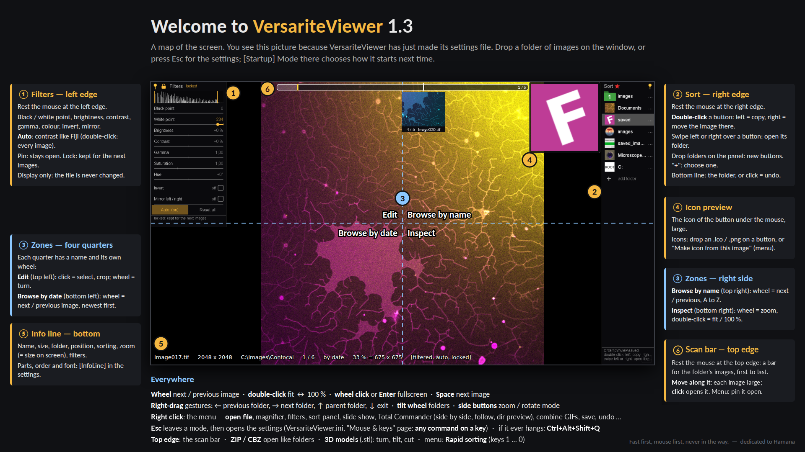

# VersariteViewer 1.1
*formerly MView*
## Written with support from Claude/Opus5.5 and ChatGPT

A fast native Windows image viewer, driven by the mouse. Made at the microscope bench, for
browsing whole experiment folders, and good at any other kind of image collection.
By [Versarite](https://github.com/versarite). Free software under the GNU GPL v3.
Pascal/Lazarus is underappreciated. It is powerful and beautiful at the same time, but
not documented well enough. Claude and ChatGPT helped me greatly to unlock the capabilities.

**Status: release 1.1 (2026-10-19).** 1.1 answers the first testers: sort orders, several folder
lists, Rapid Sorting for very fast sorting, single keys on the key page, a scan bar for long series,
many more image formats through Windows' own codecs, ZIP / CBZ archives, a Total Commander dir
preview and lossless JPEG rotation (see [What 1.1 brings](#what-11-brings)). With 1.1 the program
got its new name, VersariteViewer; the settings of an earlier version are taken over.
Microscopy-specific work continues in a separate **microscopy edition**, Versarite Image Lab
(see [What comes next](#what-comes-next-the-microscopy-edition)).

> **Dedicated to Hamana** - written by Makito Miyano (last version 1.48, 2006),
> the viewer that showed how browsing images should feel:
> **fast first, mouse first, never in the way.**
> Hamana drew its images on the graphics card when few viewers did, read the next image
> before you asked for it, and let you drive *everything* with the mouse. Its development stopped in
> 2006 and its source was never published, so its bugs could never be fixed. VersariteViewer carries its
> ideas forward in code anyone can read, fix and extend.
> See [From Hamana to VersariteViewer](docs/From_Hamana_to_VersariteViewer.md).

## What 1.1 brings

Asked for by the first testers, built on days 27 to 30:

- **A new name:** VersariteViewer (the microscopy edition: Versarite Image Lab). The program is
  `VersariteViewer.exe`, its settings `VersariteViewer.ini`; an `MView.ini` (and the deleted-files
  folder) from before is taken over at the first start. Total Commander buttons that start
  `MView.exe` need the new name.
- **ZIP and CBZ archives** open like folders, nothing is unpacked to the disk: the pictures inside
  are listed in the side panel with their thumbnails (natural order: page2 before page10), the
  wheel walks through them, a click opens one. `[Navigation] Archives=0` switches it off.
- **Total Commander dir preview** (right-click menu): Follow switches to "folder and cursor"; a
  folder under Total Commander's cursor plays its first images in a loop, in the viewer's order
  (by name / date / random), and the info line shows how many images and subfolders it has.
  `[Sort] DirPreviewFiles` (default 3, 0 = all) and `DirPreviewDelayMs` (default 1000).
- **Rotate losslessly** (right-click menu, JPEG): 90° right / left, 180°, mirror. Only the EXIF
  orientation tag is changed, the pixels are not touched; the file keeps its date.
- **Copy / move entries between folder lists** (a folder's ⋯ menu, "Copy / move entry"): copy or
  cut an entry, then paste it after the highlighted line on another list.
- **The settings can no longer be lost:** they are written in one step and backed up at each start;
  a damaged file is restored from the backup (a tester's report).
- **Panel transparency:** `[View] PanelOpacity` (20 … 100 %, default 80), the same for all panels.

- **Order of the images** in the right-click menu: by date, by name (A–Z / Z–A), or **random**
  (choose it again for a new shuffle).
- **The sort panel, reworked:**
  - "+ add folder" on top; `[Sort] PanelLines` lays the panel out for a number of rows (larger
    text; the wheel scrolls the rest).
  - **Several folder lists:** the ◀ ▶ arrows in the panel's top line go through them; after the last
    one comes a new, empty list (an arrow turns red when that is where it leads). Each list is a
    `[DirList1]`, `[DirList2]` … section of the ini.
  - A folder's ⋯ menu is a window of its own now, left of the panel so the folders stay in sight. It
    stays open while you move a folder: **Move to top**, and Move up / down repeat while held.
    New in it: **Rename** (the name in the list only), **Make folder** / **Make subfolder**
    (`<name>_001` …, added to the list), and the icon menu starts with "Choose icon file …" (bold).
- **Rapid Sorting** (right-click menu): ten fixed folders `Selection1` … `Selection9`,
  `Selection0` in your Pictures folder (`[Sort] DefaultImageFolder`), in ten colours; **the keys
  1 … 9, 0 move the image there** (with undo). Switched off, the panel shows your list again.
- **Single keys** on the "Mouse & keys" page: letters, digits, F-keys, the number pad, punctuation
  … each can run up to three commands; the page names the keys as your keyboard layout does
  ("Ü", "Num 5"). A digit without its own entry is a Rapid Sorting key.
- **The scan bar** (after Hamana's seek bar): rest the mouse at the top edge for half a second (or
  use the command "Toggle preview"). A bar across the middle of the top stands for the folder's
  images from first to last; the mouse over it shows the image at that place, so a time lapse or
  a long series is scanned in seconds. The wheel steps one image; a click opens it.
- **The bottom edge** (with the zones off): resting there for a second switches the wheel between
  next / previous image and zoom at the mouse.
- **More image formats** through Windows' own codecs: **WebP, HEIC / HEIF, AVIF, JPEG XL, JPEG XR,
  DDS, icons** (`.ico`: the largest picture in the file) and **camera raw** files (DNG, CR2, CR3,
  NEF, ARW, ORF, RW2, RAF, PEF …). Some need a free codec from the Microsoft Store (HEIF Image
  Extensions, AV1 Video Extension, JPEG XL Image Extension, Raw Image Extension); without it VersariteViewer
  says which one.
- **A drive almost full:** a red notice when a drive VersariteViewer works with has less than 100 MB free
  (`[View] DiskWarning`).
- Also: the edit-mode frame stays upright on a turned image; Esc closes the magnifier, the filter
  panel, edit mode and the sort panel in that order; "Save image as …" can write TIFF; Auto
  re-levels a selection when the mouse button is released.

The full list: [release notes 1.1](docs/release_notes_v1.1.0.md).

## What 1.0 brought

### Fast, from the first image to the last

- **Fullscreen browsing through whole folder trees.** A background thread scans the folders; next /
  previous image and folder are instant, sorted by date or by name (natural order: Image2 before
  Image10), with wrap-around and no dialogs.
- **Never waits.** Several decode threads read the neighbours ahead; the image on screen always reads
  the disk first. Quick views (EXIF thumbnails, reduced decoding) come before the full image; holding
  the wheel switches to a skim mode that never builds up lag.
- **Drawn on the GPU** (OpenGL): tiled textures, mipmaps, pixel-exact 1:1, free rotation. A CPU
  renderer takes over when OpenGL can't be used.
- **Large images:** own fast TIFF readers (uncompressed and parallel LZW), PNG / BMP / TIFF in bands
  through Windows WIC (21600 × 21600 NASA images), JPEG through WIC with an own fallback decoder,
  GIF with animation (own decoder). Images that would not fit in memory are refused, not crashed on.
- **Fit ↔ 100 %, zoom, rotate:** 100 % shows centred in the window; the zoom mode zooms at the mouse.

### The mouse language

- **Four screen zones**, each with its own name, browsing order and commands; right-drag gestures,
  tilt wheel, side buttons. Everything lives in a readable profile (`Default.mouse`), edited on the
  "Mouse & keys" page with a "Try it here" area. The keyboard is optional.
- **A Hamana profile** (`mouse\Hamana.mouse`) gives VersariteViewer Hamana's mouse.

### Sorting after inspection

- **The sort panel** slides out at the right edge: double-click left copies, double-click right moves
  the image into a button's folder. The copy or move runs on a thread of its own; the button flashes
  in its colour when the file is really there.
- **Nothing is ever lost:** never overwrites, never really deletes (a deleted-files folder), undo up to
  50 steps, every action in `sorting.log`.
- **Icons on the buttons** from `.ico` / `.png` files, or made from the image itself ("Make icon from
  this image"). Resting the mouse on a button shows its icon large at the top of the screen.
- **Into a folder:** swipe left or right over a button, or click it with the wheel.
- **Folders from Total Commander or Explorer:** drop them on the panel to make buttons.

### Looking closer

- **Display filters** at the left edge: black / white point, brightness, contrast, gamma, saturation,
  hue, invert, mirror left / right. Applied by a shader on the graphics card (one frame even on
  100-megapixel images); the image file is never changed.
- **Auto** sets the black and white point like Fiji's Auto contrast, from a live histogram (or from a
  selection); double-click makes it work on every image, `[Filters] AutoFilter=1` from the start.
- **Lock filters** keeps them for the next images; **Apply filters (and rotation) to a copy** makes
  a new image with them in its pixels, ready to save or sort.
- **The magnifier:** a round lens over the image, 1.25 to 32 × from the full image, with optional
  sharpening, lockable in place.
- **Resize to the size shown:** the info line shows the size on screen (`52 % = 1997 x 1331`); one
  menu entry makes a copy of exactly that size.

### A viewer for Total Commander

- **Follows Total Commander:** its folder, or even the file under its cursor. A **TC** label shows the
  state (see-through, light blue, amber) and switches it with a click.
- **Only one VersariteViewer:** opening images from Total Commander one after another goes to the running
  VersariteViewer, which comes to the front.
- **Side by side:** VersariteViewer on the left half of the screen, Total Commander on the right.
- See [Working with Total Commander](#working-with-total-commander) below.

### Everyday details

- **Edit mode:** select an area, crop it; save an image, a crop or a picture pasted from the
  clipboard (Ctrl+V) as PNG.
- **The info line is yours:** `[InfoLine]` in VersariteViewer.ini lists its parts (file name, size, folder,
  position, videos, sorting, zoom, state, animation, filters, messages); switch each on or off,
  move the lines to change the order, choose the font.
- **Videos are counted, not shown:** the info line says "3 videos" when a folder has them, and a
  folder with only videos says so instead of looking empty.
- **Drive roots** (C:\, a network share) open without their subfolders unless you want them
  (`[Navigation] RecurseFromDriveRoot`), so a whole drive is never scanned by accident.
- **Safe:** emergency exit (Ctrl+Alt+Shift+Q), a shutdown deadline, decode threads stuck on a failing
  disk are replaced, the window never waits for a slow drive.
- **Documented:** every unit explains itself (Purpose, Owns, Responsibilities, Does NOT, Threads),
  architecture pictures, a developer specification and a daily development log.

The full list for this release: [release notes 1.0](docs/release_notes_v1.0.0.md).

## What comes next: the microscopy edition

The microscopy edition, **Versarite Image Lab**, is in development (0.1: Leica .lif files and their
stacks, metadata, calibration, measuring with real units, scale kept in crops and saved files).
With 1.0 the general viewer was finished. Everything specific to microscopy, and to image editing,
goes into a **second program, the microscopy edition**, so VersariteViewer stays the lean, fast viewer it is.
It is not a fork: both programs are built from the same source tree, so every fix to the renderer,
the decoders or the navigation reaches both with one rebuild. The microscopy edition has its own
project file, and its units live in their own folder (`source\microscopy\`).

Planned for it:

- **Instrument metadata:** Leica (.lif / .lei and LAS X exports with their MetaData), Nikon, and the
  usual TIFF / OME / ImageJ descriptions, shown in a panel.
- **Calibration** per objective (by numbers, or by measuring a stage micrometer or a known object),
  so camera images without metadata get a real scale too.
- **Measuring:** a straight line that follows the mouse after the first click and shows its length
  after the second; no dragging needed.
- **Scale bar** with round lengths, written into a saved copy for figures.
- **A provenance note** in saved PNGs listing what was done to the image.
- **Movies and camera recordings** (Prosilica, Thorlabs, Imaging Source, Point Grey: raw AVI, TIFF
  stacks, MP4 / MKV through FFmpeg's libraries) as frame stacks with time stamps.
- **Editing**, with the keyboard allowed: Photoshop .8bf filters (64-bit), and Fiji / ImageJ plugins
  and macros run by Fiji itself.

## Using it

- The very first start shows `VersariteViewer_welcome.png`, a map of the screen (keep it next to
  `VersariteViewer.exe`; it is in `docs\`).
- Start `VersariteViewer.exe` with a file or folder, or drop one on the window. Without one,
  `[Startup] Mode` decides: 1 (default) the viewer fullscreen in the last folder, 2 the same side
  by side with Total Commander, 0 the settings screen.
- The mouse profile `Default.mouse` says what each button, wheel, gesture and zone does.
  `mouse\Hamana.mouse` gives VersariteViewer Hamana's mouse: copy it next to `VersariteViewer.ini` first,
  then set `Profile=Hamana.mouse` under `[Mouse]` (`Profile=Default.mouse` goes back).
- Sorting: rest the mouse at the right edge (or right-click menu, "Sort panel"). Double-click
  left copies, double-click right moves the image into a button's folder; drop folders from
  Total Commander or Explorer onto the panel to add buttons. Nothing is ever overwritten or
  really deleted ("Delete current image" moves the file to a deleted-files folder).
- Filters: rest the mouse at the left edge (or right-click menu, "Filters"). Black / white point,
  brightness, contrast, gamma, saturation, hue, invert, mirror; **Auto** sets the black and white
  point like Fiji (click: once, double-click: for every image). Display only; "Apply filters to a
  copy" makes a new image with them (and with the rotation, if the view is turned).
- Magnifier: right-click menu, "Magnifier (lens)". Left drag sideways = magnification, up / down =
  size, wheel = sharpening, wheel click = lock the lens.
- The info line: `[InfoLine]` in the settings screen (VersariteViewer.ini). The help text on the right says
  what each line does.
- Several folder lists: the ◀ ▶ arrows in the sort panel's top line. Rapid Sorting: right-click
  menu, then the keys 1 … 0.
- The scan bar: rest the mouse at the top edge; move along the bar to see the folder's images.
- Keys: "Mouse & keys" page, "Keys", "Add a key".
- Esc closes the scan bar, the magnifier, the filter panel, edit mode and the sort panel, in that
  order, then goes to the settings screen; Esc there exits.
- If VersariteViewer ever hangs: Ctrl+Alt+Shift+Q.

## Working with Total Commander

VersariteViewer doesn't try to be a file manager: [Total Commander](https://www.ghisler.com) is the
tree manager, VersariteViewer is its viewer. They work together in five ways:

- **Dir preview** (right-click menu, "Total Commander dir preview"): with the cursor on a folder in
  Total Commander, its first images play in a loop (`[Sort] DirPreviewFiles`, `DirPreviewDelayMs`),
  with its image and subfolder count in the info line; on a file, the file is shown as usual.
- **Opening from Total Commander.** Make VersariteViewer the program for image files (Enter or a double-click
  opens it). With `[Startup] OnlyOneInstance=1` (the default) there is only ever one VersariteViewer: an image
  opened while VersariteViewer runs goes to the running VersariteViewer, which comes to the front.
- **Following Total Commander** (right-click menu "Follow Total Commander", or click the **TC**
  label in the bottom right corner to cycle):
  - *Its folder:* when Total Commander's active panel changes folder, VersariteViewer shows that folder.
  - *Its folder and the image under its cursor:* arrow through a folder in Total Commander and
    VersariteViewer shows each image as the cursor reaches it, VersariteViewer becomes Total Commander's viewer.
  - The **TC** label shows the state: see-through = not following (off, or Total Commander isn't
    running), light blue = its folder, amber = folder and cursor.
  - While VersariteViewer follows, Total Commander decides the folder: folders are opened without their
    subfolders, the image steps wrap around inside the folder, and a folder step in VersariteViewer shows a
    short notice ("TC connection: directory change disabled!") instead.
  - Archives, FTP and plugin folders in Total Commander are ignored. VersariteViewer only reacts to changes
    in Total Commander, never pulls you back from your own browsing in VersariteViewer.
- **Side by side** (right-click menu, or the button on the settings screen): VersariteViewer on the left half
  of the screen, Total Commander on the right half, in the image's folder (from the settings
  screen: the last session's folder, else Documents).
- **Sorting with folders from Total Commander:** drag folders from Total Commander onto the open
  sort panel to make them sort buttons.

How it works: Total Commander announces nothing, so VersariteViewer asks it a few times a second through its
documented window messages (`WM_USER+50`, see the Total Commander wiki) and its `WM_COPYDATA`
questions ("SP" = the active panel's path, "SN" = the name under the cursor). It costs nothing
noticeable and needs no plugin or setting in Total Commander. `[Sort] FollowTotalCommander=0/1/2`
keeps the choice; `[Sort] TotalCommander=` can name the program if VersariteViewer doesn't find it itself.
Tested with Total Commander 11.03 (64-bit).

## Building

- Lazarus 4.x with Free Pascal 3.2.2, Windows 64-bit.
- Lazarus packages: **BGRABitmapPack** (install through the Online Package Manager),
  **LazOpenGLContext** and **SynEdit** (both come with Lazarus).
- Open `VersariteViewer.lpi`, build. The program goes to `build\VersariteViewer.exe`.
- Tests: `test\build_test.bat` builds and runs TestNavigation, TestExif, TestMouse, TestSort,
  TestFilters, TestGif and TestExtensions.
- The new image formats (WebP, HEIC, AVIF, JPEG XL, camera raw …) are read by Windows' own codecs;
  some need a free extension from the Microsoft Store (HEIF Image Extensions, AV1 Video Extension,
  JPEG XL Image Extension, Raw Image Extension). VersariteViewer itself needs nothing extra.

## Documentation

- `specs\` — the developer specification
- `docs\architecture\` — how the units depend on each other and work together at run time (1.1)
- `docs\dayNNN.log` — the development log, one file per day
- `docs\Strategy_Phase_G.md` — the plan for sorting, metadata, magnifier and filters
- `docs\release_notes_*.md` — what each release brings (`release_notes_v1.0.0.md`, `release_notes_v1.0.1.md`,
  `release_notes_v1.1.0.md`)
- `docs\Hamana_Research.md`, `docs\Hamana_Commands.md` — what was learned from Hamana
- `docs\From_Hamana_to_VersariteViewer.md` — the homage: what VersariteViewer kept, what it changed, and why

## Principles

Fast first, mouse first, never in the way.
No frills, every feature must improve the workflow.
Every module should be easy to understand.
Every design decision should be documented.
The source code should teach as well as implement.

## License

VersariteViewer is free software: you can redistribute it and/or modify it under the terms of
the GNU General Public License, version 3 (see `LICENSE`).

It is built with the Free Pascal runtime and the Lazarus LCL (modified LGPL), BGRABitmap
(modified LGPL) and pasjpeg (Independent JPEG Group licence).

## What is not in this repository

- Hamana itself: its program, plug-ins, manual and screenshots belong to its author.
  VersariteViewer contains no Hamana code, formats, artwork or text.
- The microscopy edition (Versarite Image Lab, `source\microscopy\`, its project file and tests): in
  development, published when it is ready. The shared units it plugs into (uEdition, uExtensions,
  uContainers) are here; in VersariteViewer they serve the ZIP / CBZ archives.
- The author's own test images (microscopy data, photos, very large images). Only the test sets
  the tests need are included: `test\images\gif`, `test\images\exif` and `test\images\thumb`,
  all made for testing.
